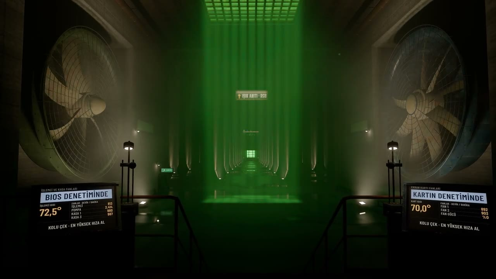
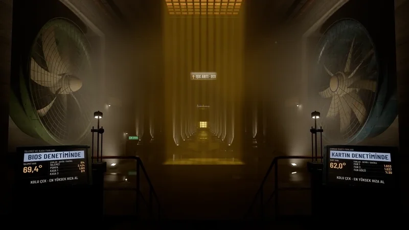
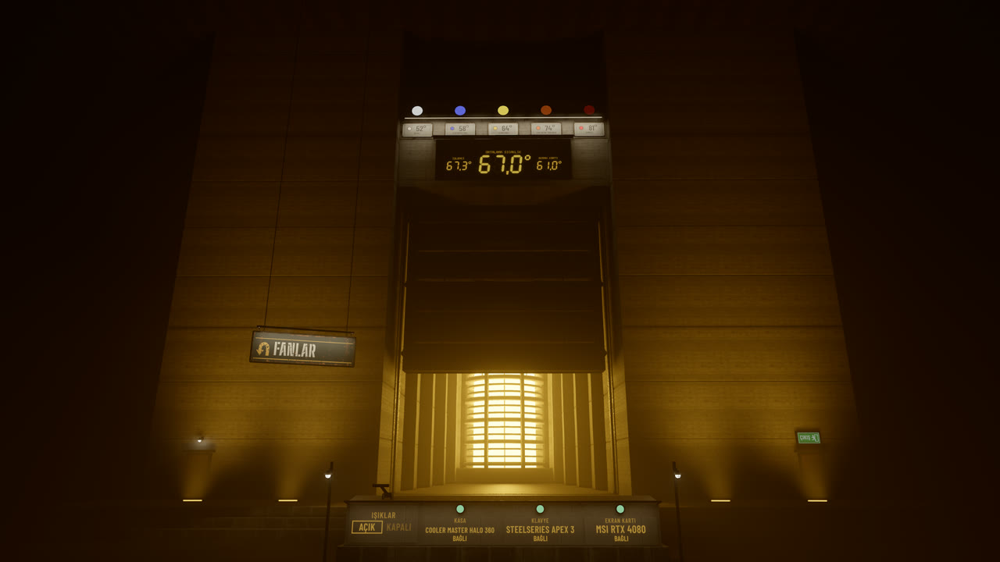
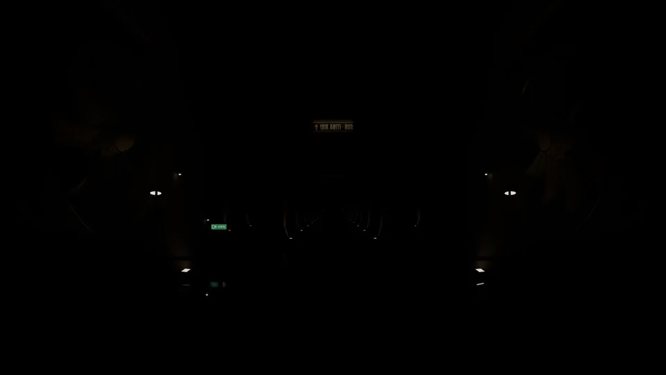
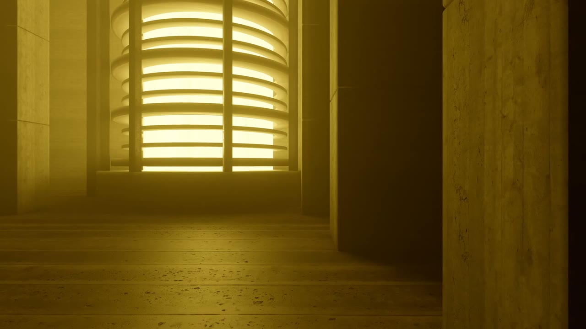
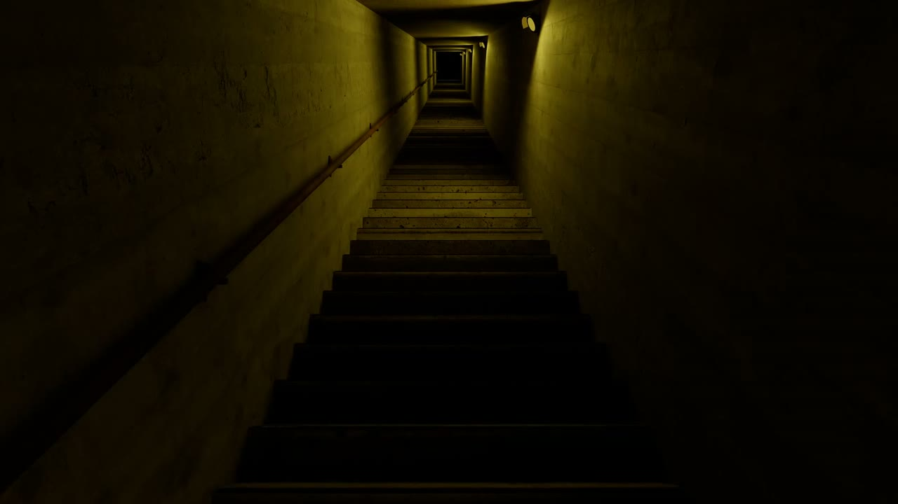
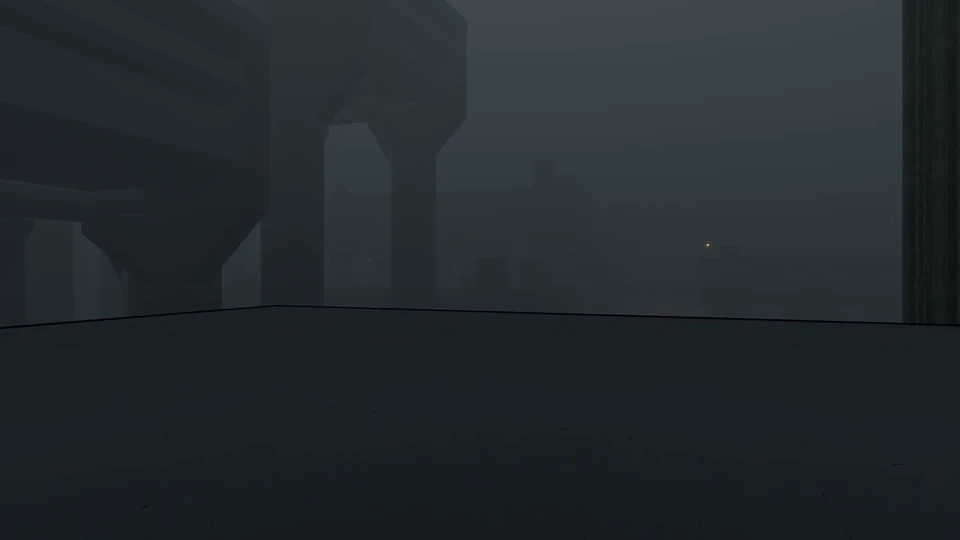

# Kontrol Merkezi

**Bilgisayarımın fanları ve RGB ışıkları tek bir Windows uygulamasında, içinde yürünen 3B bir salon olarak.**

*[English](README.md)*

> **Bu proje hakkında.** Bu proje, kişisel bilgisayarımın soğutma sistemini ve ışıklandırmasını kontrol etmek için
> geliştirdiğim deneysel bir konsept çalışmadır. Yapay zekânın sanatta ve sistem bileşenlerini yönetmede nereye
> kadar gidebildiğini sınamak için yapıldı. Son kullanıcı için geliştirilmedi ve tek bir sisteme göre ayarlandı.
> Kendi bilgisayarınızda çalışması için donanımınıza göre uyarlamanız gerekir; performans sorunları yaşanabilir.

Program iki küçük iş yapar. İşlemci, kasa ve ekran kartı fanlarını en yüksek hızla normal denetimleri arasında
değiştirir; üç cihazın ışığını açıp kapatır ve bilgisayarın sıcaklığına göre renklendirir. Bunun için iki sayfa
yeter. Projenin amacı, bu kadar küçük bir aracın görselliğinin ve sunumunun ne kadar ileri götürülebileceğini
görmekti: pencerenin tamamı gerçek zamanlı tek bir 3B sahne, sis içinde beton sütunlu bir yeraltı taşkın salonu. Her
düğme ve her gösterge o dünyanın içinde bir nesne.

## Donanımda ne yapar

- **Fanlar.** Bir kol bütün işlemci ve kasa fanlarını en yüksek hıza alır, tekrar çekilince BIOS eğrisine döndürür.
  Anakarttaki Nuvoton NCT6687D çipine doğrudan yazar: en yüksek hızdan önce çipten okunan değerler saklanır, dönüşte
  aynen geri yazılır ve yeniden okunarak doğrulanır. İkinci kol ekran kartı fanlarını en yüksek hıza alır ve kartın
  kendi otomatiğine döndürür (NvAPI soğutucu denetimi). Servis kapanır ya da çökerse kartın fanları otomatiğe döner.
- **Işıklar.** Cooler Master Halo 360 sıvı soğutucu (84 LED), SteelSeries Apex 3 klavye ve MSI RTX 4080 Gaming X
  Trio birlikte açılır, birlikte kapanır. Açıkken renk, işlemci ve ekran kartı sıcaklığının düz ortalamasını yaklaşık
  30 saniyeye yayarak izler: 52 °C'ye kadar beyaz, 58'de koyu mavi, 64'te sarı, 74'te turuncu, 80,5'ten sonra
  kırmızı. Renkler OKLCh'de karışır, bu yüzden maviden sarıya giderken yeşilden geçer. Fare ve klavye 15 dakika
  kullanılmazsa ışıklar yumuşakça söner, ilk dokunuşta geri yanar.
- **Cihazlara hiçbir şey kaydedilmez.** Her sürücü yalnız cihazının geçici (canlı) renk yolunu kullanır ve izin
  verilen komut baytlarının kısa bir listesini taşır; listede olmayan bir komut gönderilmeden hata verir. Kaydetme,
  flash ve kalıcı kip komutları hiç gönderilmez; her cihaz kendi açılış hâlini korur (ekran kartı her açılışta kendi
  kayıtlı beyazıyla yanar).
- **Pencerenin ışığı kasanın ışığıdır.** Salon, ışıkların o an gösterdiği renkle aydınlanır.

## Nasıl yapıldı

**İki süreç, tek exe.** `KontrolMerkezi.exe` (C#, .NET Framework 4.8) ya servis ya pencere olarak çalışır. Servis
oturum açılınca yönetici yetkili bir zamanlanmış görevle (UAC sormadan) başlar ve bütün cihazlar ondadır: fan çipi
ve işlemci sıcaklığı LibreHardwareMonitor ve PawnIO sürücüsüyle, ekran kartı sıcaklığı ve yükü NVML ile, kartın
fanları NvAPI ile, USB ışıkları HID ile. Işığı saniyede 30 kez hesaplar; her cihazın kendi yazıcı iş parçacığı
vardır, yavaş bir cihaz ötekileri bekletmez, eskiyen kareyi atlar. Pencere yetkisiz çalışır, hiçbir donanıma
dokunmaz, servisle adlandırılmış bir boru üzerinden satır satır JSON konuşur ([`docs/PROTOKOL.md`](docs/PROTOKOL.md)).

**RGB sürücüleri**, OpenRGB 1.1'deki protokol bilgilerinden (komut baytları, rapor düzenleri, zamanlamalar) yazılmış
küçük HID sürücüleridir ([`docs/RGB_SURUCULER.md`](docs/RGB_SURUCULER.md)). Ekran kartının ışık denetleyicisi kartın
I2C hattında, NvAPI'nin arkasındadır. Onun için MSI'ın kendi yazılımının yaptığı yazmaç yazmaları NvAPI'ye takılan
küçük bir kancayla kaydedildi ([`araclar/nvspy/`](araclar/nvspy), [`docs/GPU_ISIK_PLANI.md`](docs/GPU_ISIK_PLANI.md))
ve karta yalnız o (yazmaç, değer) çiftleri tekrar gönderilir.

**Salon** ([`docs/SALON.md`](docs/SALON.md)) ışık rengi canlı değişen durağan bir sahnedir:

- Çevrimdışı bir fırın ([`sahne/firin/`](sahne/firin), C++ ve CUDA, OptiX üstünde) ışığı her ışık grubu için beyaz
  olarak yol izlemeyle hesaplar: küresel harmoniklerin ilk iki bandını (L0 ve L1 yönü) tutan ışık haritaları ve sis
  ile hareketli parçalar için ortalama ışınım ve akı tutan 3B hacimler. Texel başına 1024 örnek, MIS ile doğrudan ışık
  örneklemesi ve doğrudan aydınlanan texellerden türetilen ikincil ışıklar. Her rastgele sayı texelin ve örneğin
  karmasıdır; aynı girdi aynı baytları verir. Yüzeyler xatlas ile açılır, kamera yollarına uzaklığa göre yerleşir.
- Işık taşınımı yayılan ışıkta doğrusal olduğu için pencere her grubu sıcaklık rengiyle canlı boyar; renk değişince
  pişirme yeniden yapılmaz.
- Canlı çizici ([`ui/salon/`](ui/salon), WebView2 içinde WebGL2, kütüphanesiz düz betik ve gölgelendiriciler)
  sahneyi 2,5 kat süper örneklemeyle çizer: ışık haritaları, saklanan ışık yönünden GGX parlama, ıslak zemin için
  aynalı yansıma geçişi, fanların karıştırdığı ve pişmiş hacimlerin içinden ışın yürütülen sis, bloom, AgX ton
  eşleme ve Lanczos ile küçültme. TAA yok, çalışırken rastgele sayı yok: her karede aynı örnekler, bu yüzden kamera
  hareket ederken görüntü kıpırdamaz. Küçük lambalar ve ince ışık şeritleri kaynağında süzülür, yanıp sönmez.
- Kare temposu tasarımın parçasıdır: kare, ölçülen tazeleme hızının sabit bir katında çizilir (165 Hz'de her üç
  tazelemede bir), animasyon zamanı tam tazelemelerle ilerler. RTX 4080 ile 2560 × 1440 gerçek pencerede ölçüldü:
  baştan sona bir yürüyüşte her 10 saniyelik pencerede p99 kare aralığı en fazla 19,3 ms; açılıştan ilk kareye
  yaklaşık 4 saniye.

**İçinde dolaşmak.** RGB levhasına tıklayınca kamera salon boyunca yaklaşık 250 m uçarak kemere gider; ışık
şalteri, beş renk durağı lambası, sıcaklık göstergesi ve üç cihazın lambaları oradadır. `Y` yürüyüş kipini açar
(WASD, fareyle bakış, sahnenin üçgenlerine karşı bir işçide çarpışma): ısı odası, yan geçitler, 182 basamaklı bir
merdiven ve çatıya açılan bir kapak. Çatıdan, beton sütunlar üstünde özdeş tesislerin durduğu sisli bir boşluğa
atlanabilir; her tesisin kendi sıcaklık renginde bir lambası var. Düşerken yön verilir, hangi çatıya ulaşılırsa oraya
inilir; sisin altında sütunlar bir kiriş ağıyla birbirine bağlanır.

**Yükleme ekranı** karanlıktaki salonun kendisidir: on aydınlatma devresi önden arkaya doğru, gerçek yükleme
ilerlemesine göre tek tek yanar; son resim sahnenin ilk karesidir.

| Kapağın arkasındaki ısı odası | Çatıya çıkan merdiven |
| --- | --- |
|  |  |

## Çalıştırmak

### Salonu tarayıcıda görmek (donanım gerekmez)

WebView2 dışında sayfa benzetilmiş bir servisle çalışır; sahne güçlü bir ekran kartı olan her makinede Chromium
tabanlı bir tarayıcıda (Edge ile denendi) görülebilir.

1. Son [sürümün](https://github.com/OzcanOrhanDemirci/kontrol-merkezi/releases/latest) bütün dosyalarını
   `sahne/paket/` klasörüne indirin ve `.tar` dosyasını orada açın (`doku/` ve `model/` onun içinde). Yaklaşık 0,9 GB.
2. Depo kökünde: `python -m http.server 8000`
3. Tarayıcıda: `http://127.0.0.1:8000/ui/index.html#paket=/sahne/paket/`

Tuşlar: `Tab` fanlarla kemer arasında gider, `Y` yürüyüş kipi (`Esc` çıkar), `R` ışıkları açar ya da kapatır, `T`
sıcaklık taraması, `1`-`6` bir renk durağında sabitler, `F1` benzetim tuşlarının listesi.

### Windows'ta derlemek ve kurmak

Windows 10 ya da 11 (x64), .NET Framework 4.8 hedefleme paketiyle .NET SDK ve WebView2 Runtime gerekir.

1. Sahne paketini yukarıdaki gibi `sahne/paket/` klasörüne koyun (derleme onu exe'nin yanına kopyalar).
2. `dotnet build -c Release`
3. `Kurulum.cmd`'yi çalıştırın (bir kez yönetici izni ister). `bin\Release`'i `C:\Program Files\KontrolMerkezi`'ye
   kopyalar, oturum açılışında servisi başlatan `KontrolMerkezi` görevini kaydeder, "Kontrol Merkezi" kısayolunu
   koyar ve algılayıcılardan salt okuma bir döküm alır (`kur-gunluk.txt`). `kur.ps1 -Kaldir` hepsini geri alır.

Fan çipi ve işlemci sıcaklığı [PawnIO](https://pawnio.eu) sürücüsünü ister; kurulum onu kurmaz.
`KontrolMerkezi.exe oku`, servisin görebildiği her şeyin salt okuma dökümünü yazar.

Çalışırken veriler `%LOCALAPPDATA%\KontrolMerkezi\` altındadır: `gunluk.txt` (ne olduysa), `isi-gecmisi.csv`
(dakikada bir sıcaklık), `ayarlar.json` (renk durakları ve cihaz başına renk eşleme; servis yeniden başlayınca
geçerli olur).

### Sahneyi pişirmek

`sahne/firin/build.bat`, `salon.exe`'yi MSVC, CMake ve Ninja ile derler. CUDA araç takımı ve OptiX SDK gerekir; ikisi
de bu depoda yok, `C:/dev/pc_graphics/third_party` altında aranır (CMake'te `PCG_TP` ile değişir).
`python sahne/varlik.py` dokuları ve modelleri Poly Haven'dan indirir. Sürümdeki paket, pencereyi çalıştırmak için
bunların hiçbirine gerek kalmasın diye var.

## Sınırlar

- **Tek bir bilgisayar için yapıldı.** Fan yazmaları yalnız NCT6687D çipinde açıktır. Ekran kartının ışığı yalnız
  PCI kimliği 10DE:2704 / 1462:5111 olan kartta (MSI RTX 4080 Gaming X Trio) sürülür. RGB sürücüleri yalnız yukarıdaki
  üç cihazı tanır. Başka donanımda bu parçalar kendini kullanılamaz olarak gösterir; çalışmaları için kendi
  cihazlarınıza göre yazmanız gerekir. Kod bir fan denetleyicisine ve ışık denetleyicilerine yazar; uyarlamadan önce
  [`docs/RGB_SURUCULER.md`](docs/RGB_SURUCULER.md)'yi ve `src/Donanim/FanCipi.cs`'deki açıklamaları okuyun.
- **Performans.** Çizici RTX 4080'de, 2560 × 1440'ta ayarlandı. Süper örnekleme ve sis kalitesi o kartın bütçesine
  göre seçildi; daha zayıf bir ekran kartında pencere yavaş olur. Geliştirme sırasında yük altında ara ara kısa
  takılmalar görüldü; baş şüpheli RTSS'in WebView2'ye kanca takması, hiç dışlanmadı.
- **Denenmeyenler:** birden çok monitör, %100 dışındaki ekran ölçekleri, RTX 4080 dışındaki ekran kartları, AMD ya da
  Intel grafik.
- **Dil.** Uygulamanın gösterdiği her şey Türkçe. `docs/` altındaki tasarım notları çoğunlukla İngilizce.
- Otomatik test takımı ve CI yok. Denetimler `araclar/` altında, gerçek pencereyi ya da başsız bir tarayıcıyı süren
  ölçüm betikleri.

## Depo

| Yol | Ne |
| --- | --- |
| `src/` | C# servis ve pencere: `Donanim` (fan çipi, kart fanları, algılayıcılar), `Rgb` (cihaz sürücüleri), `Isik` (renk motoru), `Servis`, `Pencere` |
| `ui/` | sayfa: uygulama mantığı, benzetilmiş servis, yükleme ekranı, yazı tipleri; `ui/salon/` WebGL2 çizici ve gölgelendiricileri |
| `sahne/firin/` | ışık fırını (C++, CUDA, OptiX) ve salonu kodla kuran sahne kurucusu |
| `sahne/araclar/`, `araclar/` | paket araçları, ölçüm, kayıt ve deneme betikleri |
| `docs/` | tasarım notları: protokol, RGB sürücüleri, kartın ışığı, salon |
| `lib/` | uygulamanın kullandığı derlenmiş .NET kütüphaneleri |

## Nasıl üretildi

Neyin yapılacağına, nasıl görünüp nasıl davranacağına ben karar verdim ve her adımı kendi bilgisayarımda, gerçek
ışıklarda denetledim. Kod, gölgelendiriciler ve araçlar yapay zekâyla (Claude Code, bazı parçalarda Codex) Kasım
2026'da iki günde yazıldı. Commit geçmişi işi adım adım kaydeder.

## Üçüncü taraf kod ve varlıklar

| Parça | Kaynak | Lisans |
| --- | --- | --- |
| `src/Rgb/CoolerMasterA1.cs`, `src/Rgb/SteelSeriesApex3.cs` | protokol ve komut dizilerinin bir kısmı [OpenRGB](https://gitlab.com/CalcProgrammer1/OpenRGB) 1.1'i izler | GPL-2.0-or-later |
| `lib/LibreHardwareMonitorLib.dll` 0.9.6, `BlackSharp.Core`, `DiskInfoToolkit`, `RAMSPDToolkit-NDD` | [LibreHardwareMonitor](https://github.com/LibreHardwareMonitor/LibreHardwareMonitor) ve bağımlılıkları | MPL-2.0 |
| `lib/HidSharp.dll` 2.6.4 | [HidSharp](https://www.zer7.com/software/hidsharp), James F. Bellinger | Apache-2.0 |
| `lib/System.*.dll`, `Microsoft.Bcl.HashCode.dll` | .NET kütüphaneleri, Microsoft | MIT |
| `sahne/firin/third_party/xatlas` | [xatlas](https://github.com/jpcy/xatlas), Jonathan Young | MIT |
| `ui/fonts/` | Barlow, Big Shoulders Stencil, IBM Plex Mono, Instrument Serif | SIL Open Font License 1.1 |
| sahne paketindeki dokular ve modeller | [Poly Haven](https://polyhaven.com) | CC0 |

Kontrol Merkezi, GNU Genel Kamu Lisansı sürüm 2 ya da sonrasıyla lisanslıdır; NVIDIA'nın CUDA, OptiX, NvAPI ve NVML kitaplıklarıyla bağlanmaya izin verilir: [LICENSE](LICENSE) ve [NOTICE](NOTICE). GPL, OpenRGB'nin kodu üzerine kurulan iki RGB sürücüsünden gelir.
