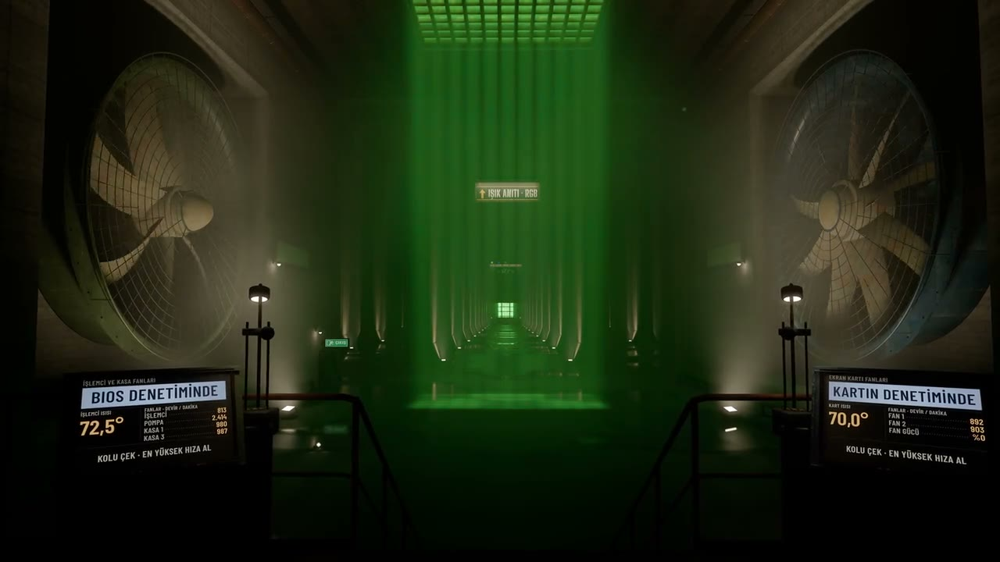
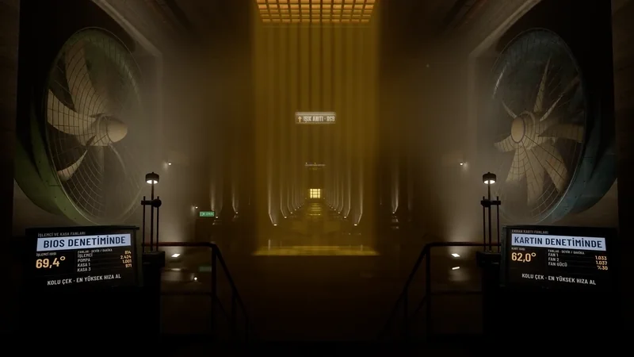
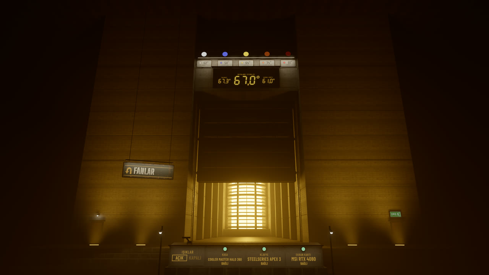
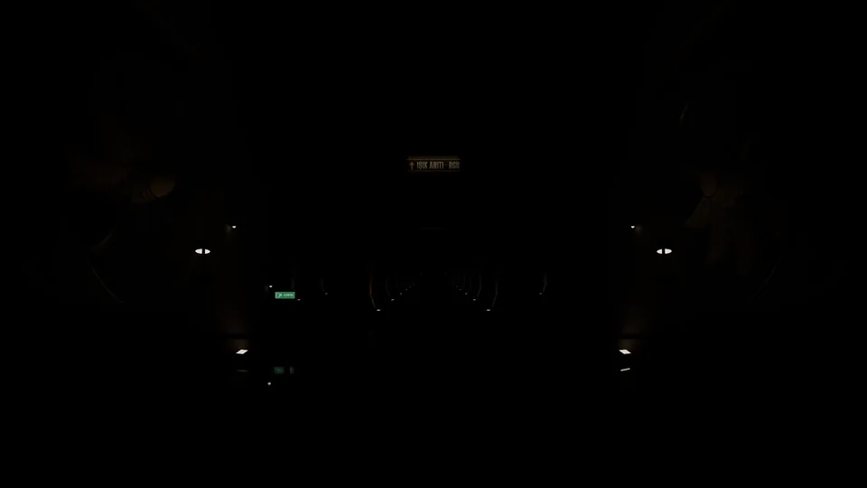
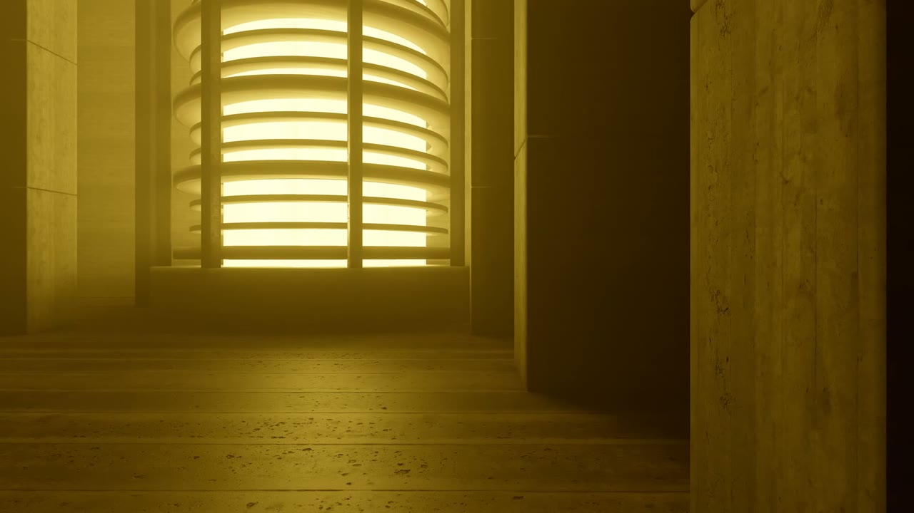
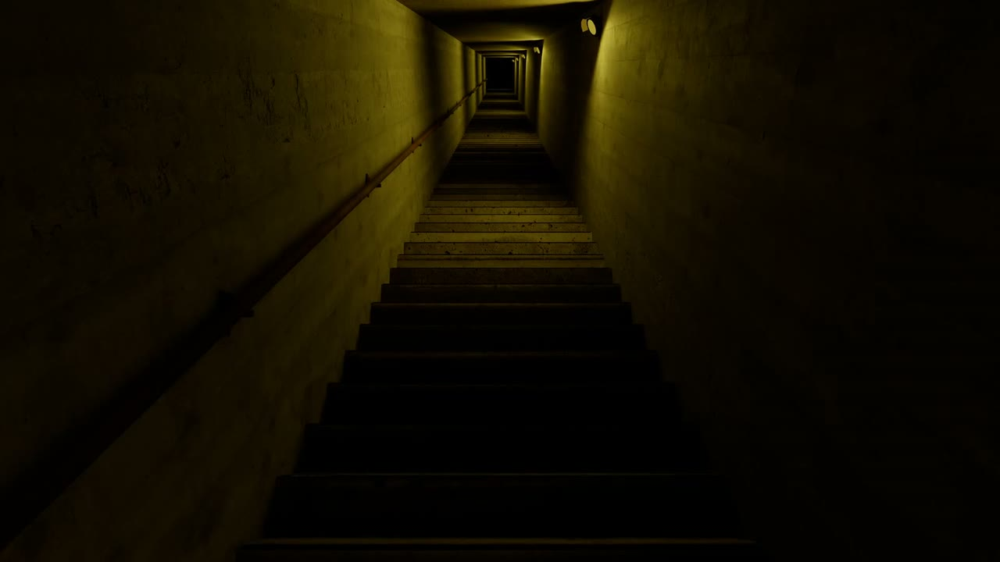
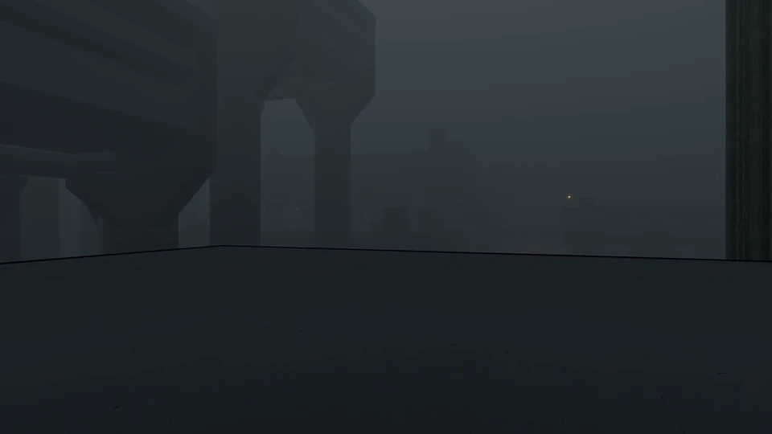

# Kontrol Merkezi

**The fans and RGB lighting of my PC in one Windows app, staged as a 3D hall you walk through.**

*[Türkçe](BENIOKU.md)*

> **About this project.** This is an experimental concept I built to control the cooling and lighting of my own
> computer. It is also an experiment in how far AI can be taken in art and in managing system components. It was not
> made for end users and is tuned for a single machine. To run it on yours you will have to adapt it to your own
> hardware, and you may run into performance problems.

The program does two small things. It switches the CPU, case and GPU fans between full speed and their normal
control, and it turns the lights of three devices on or off, coloured by the temperature of the machine. That
needs two pages. The point of the project was to see how far the visuals and the presentation of such a small
utility can be pushed: the whole window is one real-time 3D scene, an underground flood-water hall of concrete
columns in haze, and every control and every reading is an object in that world.

## What it does on the hardware

- **Fans.** One lever puts every CPU and case fan on full speed and back to the BIOS curve. It writes the
  motherboard's Nuvoton NCT6687D directly: the values read from the chip before full speed are kept and written back,
  then read again to check. A second lever puts the GPU fans on full speed and back to the card's own automatic
  control (NvAPI cooler control). If the service exits or crashes, the GPU fans go back to automatic.
- **Lights.** The Cooler Master Halo 360 AIO (84 LEDs), the SteelSeries Apex 3 keyboard and the MSI RTX 4080 Gaming
  X Trio all go on and off together. When on, their colour follows the plain average of the CPU and GPU temperature,
  smoothed over about 30 seconds: white up to 52 °C, dark blue at 58, yellow at 64, orange at 74, red from 80.5. The
  colours are mixed in OKLCh, so the way from blue to yellow passes through green. After 15 minutes without mouse or
  keyboard input the lights fade out and come back on the first touch.
- **Nothing is stored on the devices.** Every driver uses only the volatile live-colour path of its device and has a
  short allow-list of command bytes; anything else throws before it is sent. Save, flash and stored-mode commands are
  never sent, so each device keeps its own power-on state (the GPU always wakes up in the white it has stored).
- **The window's light is the case's light.** The hall is lit in the colour the lights show at that moment.

## How it is built

**Two processes, one executable.** `KontrolMerkezi.exe` (C#, .NET Framework 4.8) runs either as the service or
as the window. The service starts at logon as an elevated scheduled task (no UAC prompt) and owns every device: the
fan chip and CPU temperature through LibreHardwareMonitor and the PawnIO driver, GPU temperature and load through
NVML, GPU fans through NvAPI, the USB lights through HID. It computes the light 30 times a second, with a writer
thread per device so a slow device skips stale frames instead of delaying the others. The window is unelevated,
touches no hardware and talks to the service over a named pipe in line-delimited JSON
([`docs/PROTOKOL.md`](docs/PROTOKOL.md)).

**The RGB drivers** are small HID drivers written from the protocol facts in OpenRGB 1.1: command bytes, report
layouts and timings ([`docs/RGB_SURUCULER.md`](docs/RGB_SURUCULER.md)). The GPU's light controller sits on the
card's I2C bus behind NvAPI; for it, the register writes MSI's own software makes were recorded with a small hook
on NvAPI ([`araclar/nvspy/`](araclar/nvspy), [`docs/GPU_ISIK_PLANI.md`](docs/GPU_ISIK_PLANI.md)) and only those
(register, value) pairs are replayed.

**The hall** ([`docs/SALON.md`](docs/SALON.md)) is a static scene with live light colour:

- An offline baker ([`sahne/firin/`](sahne/firin), C++ and CUDA on OptiX) path-traces the light per light group in
  white: light maps that store the first two spherical-harmonic bands (L0 and the L1 direction), and 3D volumes of
  mean radiance and flux for the haze and the moving parts. 1024 samples per texel, next-event estimation with MIS,
  and secondary lights taken from the directly lit texels. Every random number is a hash of the texel and the sample,
  so the same inputs give the same bytes. Charts are unwrapped with xatlas and packed by distance to the camera paths.
- Since light transport is linear in emission, the window tints each group live with the temperature colour, so the
  bake never has to be redone when the colour changes.
- The live renderer ([`ui/salon/`](ui/salon), WebGL2 inside WebView2, plain scripts and shaders, no libraries) draws
  the scene supersampled 2.5 times, with the light maps, GGX specular from the stored light direction, a mirrored
  reflection pass for the wet floor, a ray-marched haze through the baked volumes stirred by the fans, bloom, AgX
  tone mapping and a Lanczos resolve. There is no TAA and no random numbers at run time: the same samples every
  frame, so the image holds still when the camera moves. Small lamps and thin light strips are filtered at their
  source so they do not flicker.
- Frame pacing is part of the design: the frame is drawn on a fixed cadence of the measured refresh rate (every
  third refresh at 165 Hz), with animation time in whole refreshes. Measured in the real window at 2560 × 1440 on an
  RTX 4080: p99 frame interval at most 19.3 ms in every 10-second window of a full walk, first frame about 4 s after
  start.

**Moving through it.** Clicking the RGB sign flies the camera about 250 m down the hall to the arch, where the
light switch, the five colour-stop lamps, the temperature display and the three device lamps are. `Y` starts walk
mode (WASD, mouse look, collision against the scene's triangles in a worker): through the heat chamber, side
passages, a 182-step stair and a hatch onto the roof. From the roof you can jump into a foggy void of identical
facilities on concrete columns, each with a lamp in its own temperature colour. You steer while you fall and land on
whatever roof you reach; below the fog the columns are tied together by a lattice of beams.

**The loading screen** is the hall itself in the dark: its ten lighting circuits strike one after another, front to
back, paced by the real loading progress, and the last picture is the scene's first frame.

| The heat chamber behind the gate | The stair up to the roof |
| --- | --- |
|  |  |

## Running it

### Look at the hall in a browser (no hardware needed)

Outside WebView2 the page runs against a simulated service, so the scene can be viewed in a Chromium-based browser
(tested with Edge) on any machine with a capable GPU.

1. Download every file of the latest [release](https://github.com/OzcanOrhanDemirci/kontrol-merkezi/releases/latest)
   into `sahne/paket/` and unpack the `.tar` there (it holds `doku/` and `model/`). About 0.9 GB.
2. From the repository root: `python -m http.server 8000`
3. Open `http://127.0.0.1:8000/ui/index.html#paket=/sahne/paket/`

Keys: `Tab` travels between the fans and the arch, `Y` walk mode (`Esc` leaves), `R` lights on or off, `T` a
temperature sweep, `1`-`6` hold a colour stop, `F1` the list of simulation keys.

### Build and install on Windows

Needs Windows 10 or 11 (x64), the .NET SDK with the .NET Framework 4.8 targeting pack, and the WebView2 Runtime.

1. Put the scene pack in `sahne/paket/` as above (the build copies it next to the exe).
2. `dotnet build -c Release`
3. Run `Kurulum.cmd` (it asks for administrator rights once). It copies `bin\Release` to
   `C:\Program Files\KontrolMerkezi`, registers the `KontrolMerkezi` logon task, adds a "Kontrol Merkezi" shortcut and
   takes a read-only reading of the sensors into `kur-gunluk.txt`. `kur.ps1 -Kaldir` removes it again.

The fan chip and CPU temperature need the [PawnIO](https://pawnio.eu) driver, which the installer does not install.
`KontrolMerkezi.exe oku` writes a read-only dump of everything the service can see.

### Baking the scene

`sahne/firin/build.bat` builds `salon.exe` with MSVC, CMake and Ninja. It needs the CUDA toolkit and the OptiX SDK,
which are not in this repository; it looks for them in `C:/dev/pc_graphics/third_party` (set `PCG_TP` in CMake to
change that). `python sahne/varlik.py` fetches the textures and models from Poly Haven. The release pack exists so
that none of this is needed to run the window.

## Limits

- **It is made for one PC.** The fan writes are only enabled on an NCT6687D. The GPU light is only driven on a card
  with PCI IDs 10DE:2704 / 1462:5111 (MSI RTX 4080 Gaming X Trio). The RGB drivers know only the three devices above.
  On other hardware those parts report themselves as unavailable; making them work means writing for your own
  devices. The code writes to a fan controller and to light controllers, so read
  [`docs/RGB_SURUCULER.md`](docs/RGB_SURUCULER.md) and the comments in `src/Donanim/FanCipi.cs` before you adapt it.
- **Performance.** The renderer was tuned on an RTX 4080 at 2560 × 1440. Supersampling and haze quality are spent on
  that card's budget; on a weaker GPU expect a slow window. Occasional short hitches were seen under load during
  development; RTSS hooking into WebView2 is the main suspect and was never ruled out.
- **Not tested:** multi-monitor setups, display scaling other than 100 %, GPUs other than the RTX 4080, AMD or Intel
  graphics.
- **Turkish.** Everything the app shows is Turkish. The design notes in `docs/` are mostly English, some Turkish.
- No automated test suite and no CI. The checks are measurement scripts in `araclar/` that drive the real window or
  a headless browser.

## Repository

| Path | What |
| --- | --- |
| `src/` | the C# service and window host: `Donanim` (fan chip, GPU fans, sensors), `Rgb` (device drivers), `Isik` (colour engine), `Servis`, `Pencere` |
| `ui/` | the page: app logic, the simulated service, the loading screen, fonts; `ui/salon/` the WebGL2 renderer and its shaders |
| `sahne/firin/` | the light baker (C++, CUDA, OptiX) and the scene builder that models the hall in code |
| `sahne/araclar/`, `araclar/` | pack tools, measurements, recording and test scripts |
| `docs/` | design notes: protocol, RGB drivers, GPU light, the hall |
| `lib/` | prebuilt .NET libraries the app references |

## How it was made

I decided what was built, how it should look and behave, and checked every step on my own machine and its real
lights. The code, the shaders and the tools were written with AI (Claude Code, and Codex for parts of it), over two days in November 2026. The
commit history records the work step by step.

## Third-party code and assets

| Part | Origin | Licence |
| --- | --- | --- |
| `src/Rgb/CoolerMasterA1.cs`, `src/Rgb/SteelSeriesApex3.cs` | protocol and parts of the command sequences follow [OpenRGB](https://gitlab.com/CalcProgrammer1/OpenRGB) 1.1 | GPL-2.0-or-later |
| `lib/LibreHardwareMonitorLib.dll` 0.9.6, `BlackSharp.Core`, `DiskInfoToolkit`, `RAMSPDToolkit-NDD` | [LibreHardwareMonitor](https://github.com/LibreHardwareMonitor/LibreHardwareMonitor) and its dependencies | MPL-2.0 |
| `lib/HidSharp.dll` 2.6.4 | [HidSharp](https://www.zer7.com/software/hidsharp), James F. Bellinger | Apache-2.0 |
| `lib/System.*.dll`, `Microsoft.Bcl.HashCode.dll` | .NET libraries, Microsoft | MIT |
| `sahne/firin/third_party/xatlas` | [xatlas](https://github.com/jpcy/xatlas), Jonathan Young | MIT |
| `ui/fonts/` | Barlow, Big Shoulders Stencil, IBM Plex Mono, Instrument Serif | SIL Open Font License 1.1 |
| textures and models in the scene pack | [Poly Haven](https://polyhaven.com) | CC0 |

The repository's own licence has not been chosen yet.
